<!-- ============ HEADER: хвиля + анімований текст ============ -->

  

<!-- ============ TYPING: друкований текст ============ -->

  

<!-- ============ PIXEL WORLD: генерує scripts/pixel-world.mjs з твого графіка контрибуцій ============ -->

  

<!-- ============ STACK ============ -->

  
   
  

<!-- ============ STATS: теж генеруються Action'ом у папку profile/ ============ -->

  
  

<!-- ============ CONTACTS ============ -->

  

<!-- ============ FOOTER ============ -->

  

